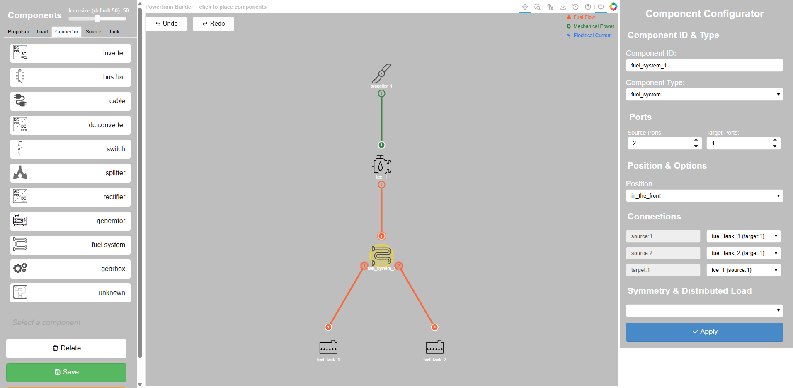

.. _builder:

===============
PT file Builder
===============
The powertrain builder graphical user interface provides a convenient way to create and edit powertrain
configurations for the FAST-OAD-CS23-HE framework. Once the powertrain configuration is created, it can be saved as a PT file
in YAML format, which can be used in later aircraft sizing or optimization.

.. toctree::
   :maxdepth: 1

    Component node placement <node_placement>
    Component connections <component_connections>
    Delete, undo and redo <undo_redo_delete>
    Node properties configuration <node_properties>
    Save & reload design <save_load>

To launch the builder, add the following code snippet to your Python script:

.. code:: python

    from fastga_he.gui.power_train_builder import PowertrainBuilderLauncher

    PowertrainBuilderLauncher.launch()

Or run the following command in the terminal:

.. code:: commandline

    powewtrain-builder

Once loaded from existing design, the builder should look like this:

To end the session simply click on the ``End Session`` button located in the bottom of the left panel. If the changes
are saved, (save button in green color), the session will be ended and the window will be closed. If the changes are not
saved (save button in yellow color), a pop-up window will appear asking if you want to save the changes before ending
the session. Select ``End Anyway`` to exit without saving, ``Save & End`` to save your changes and exit, or
``Cancel`` to continue editing.

For developers, the following links show the common action flows of the builder GUI.

.. raw:: html

    <a href="../../../powertrain_builder_action_flows.html" target="_blank">Powertrain builder runtime event flow</a> 
    

