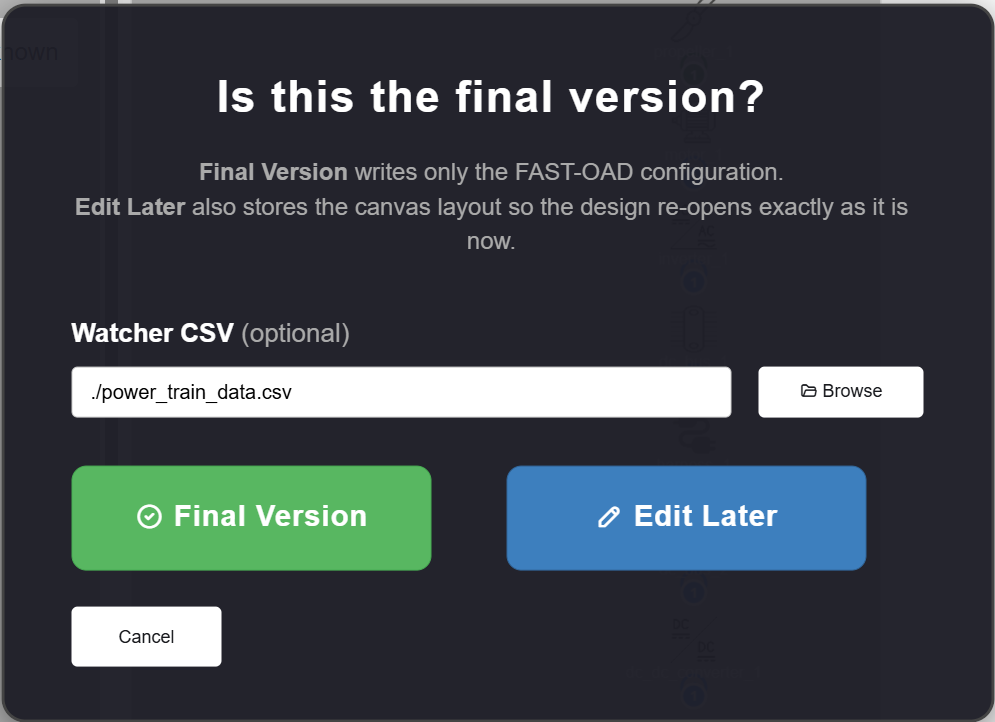
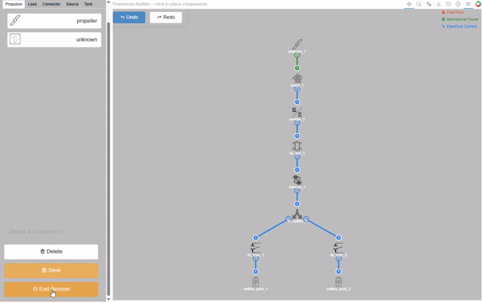

.. _save_load_session:

====================
Save & reload design
====================
The powertrain builder GUI allows users to save their current design for later aircraft design calculation or
reload it later for further editing. This feature is achieved by saving the design in PT file in YAML format with a new
dedicated ``canvas_layout`` section that registers the node coordinates and status for unknown components through the
standard file dialog window.

Saving design
=============
To save a design, click on the ``Save`` button, which triggers the path selection window for the PT watcher
csv file. The CSV file path, added at the end of the PT file, can either be hand-typed or selected from the standard
file dialog window using the ``Browse`` button. If the design is the final version that does not require further
editing, click on the ``Final Version`` button to save it without the ``canvas_layout`` section. For design requiring
further editing, click on the ``Edit Later`` button to save the design with the ``canvas_layout`` section. To cancel
the saving process, click on the ``cancel`` to abort the process.

In case the reminder pop-up window appears while ending a session with unsaved changes, the saving
process is identical to the ordinary saving process.

Reload design
=============
The reload design function can only be accessed at the startup overlay window of the builder. To reload a design, click
on the white ``Load Design`` button, which triggers the open file dialog window to search the existed powertrain
configuration file. To cancel the reloading process with a new, simply cancel the file dialog window and click on the
``New Design`` button.